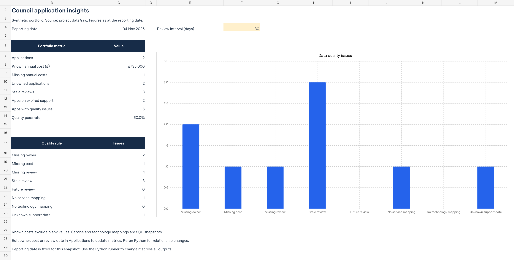

# Council Application Insights

An application portfolio reporting project built around a practical question:
**Which services depend on poorly documented or ageing technology, and what should the responsible teams review first?**

It combines application, service, technology and ownership records using SQL, produces a data-quality issue register, and supplies an Excel workbook and a three-page Power BI project.

All data is **synthetic**. Application names, teams, costs and technology support dates are invented. This is an independent portfolio project, not a Liverpool City Council system or an Ardoq integration.



*Preview of the included Excel workbook. This is not a Power BI screenshot.*

## Start here

1. Open [the Excel workbook](excel/Council_Application_Insights.xlsx) for the calculated summary and inventory.
2. Read [the findings](docs/findings.md) for the sample decisions and limitations.
3. Run the reproducible analysis below.
4. Open [the Power BI project](powerbi/CouncilInsights.pbip) using the [Power BI guide](powerbi/README.md).

## Run the analysis

Python 3.11 or newer. No API key, database server or third-party Python package is needed for the local analysis.

```bash
git clone https://github.com/devLV133/council-application-insights.git
cd council-application-insights
python insights.py
python -m unittest discover -s tests -v
```

The repository is initially private. Cloning requires access until its owner makes it public.

The runner loads the CSV files into an in-memory SQLite database, checks keys and relationships, runs the SQL views and writes CSV/JSON outputs to `data/processed/`. It does not alter the raw files. The default reporting date is **4 November 2026**, with a **180-day** review interval, to keep results reproducible.

```bash
python insights.py --as-of 2026-12-01 --stale-days 180 --out tmp/december
```

For SQL Server, use [sql_server_setup.sql](sql/sql_server_setup.sql) in a new, empty demo database. It creates and seeds the tables and views without dropping existing objects. The generated T-SQL has not been executed against a SQL Server instance in this environment.

## Included

| Component | Contents |
|---|---|
| `data/raw/` | Seven related CSV sources: 12 applications, 6 services, 6 technologies, 5 owner teams and their relationships |
| `sql/` | Relational schema, reporting views and a SQL Server setup script |
| `insights.py` | Input validation, reproducible SQL execution and report exports |
| `excel/` | Editable workbook with formulas, quality flags and a native chart |
| `powerbi/` | Native PBIP project, Power Query imports, DAX measures and 3 report pages |
| `docs/` | Business requirements, data dictionary, metric definitions, findings and validation record |
| `tests/` | Tests for financial totals, relationships, missing values and date boundaries |

## Sample results

| Metric | Result |
|---|---:|
| Applications | 12 |
| Known annual cost | £735,000 |
| Applications missing cost | 1 |
| Unowned applications | 2 |
| Stale reviews | 3 |
| Applications using expired-support technology | 2 |
| Data-quality issues | 9 across 6 applications |
| Records passing all 8 quality rules | 50% |

Known cost is not a complete portfolio budget because one cost is missing. Shared application costs are counted once, not repeated for each service or dependency. Service counts can overlap and must not be added to estimate distinct applications.

## Reporting views

- **Portfolio overview:** known costs, application counts, ownership and an inventory table.
- **Dependencies and support:** direct application dependencies, technology lifecycle and service exposure.
- **Data quality:** issue counts, affected applications and a record-level action register.

Support expiry and data quality are separate: an accurately documented application can still run on expired-support technology. An unknown support date is not evidence of current support.

## Validation and scope

The Python/SQLite analysis and its automated tests have been run. Excel totals, formula recalculation and rendered worksheets have been checked. Power BI JSON is checked against Microsoft's published schemas and its visual field references are checked against the model.

**Power BI Desktop opening/refresh, DAX execution, native visual rendering and SQL Server execution still need verification.** The PBIP source is supplied instead of claiming a tested `.pbix` file. See [validation](docs/validation.md) for the exact boundary.

This is a small analytical prototype. It does not include actual Ardoq usage, website tracking, live council data, observed stakeholder adoption or measured savings. The [requirements](docs/requirements.md) are a fictional brief, not evidence of commissioned client work.

## Refresh and develop

Edit the raw CSVs, then run:

```bash
python insights.py
python tools/build_sql_server.py
python tools/build_powerbi.py
python -m unittest discover -s tests -v
```

The workbook is a dated companion snapshot. Its owner, cost and review-date inputs drive formula results; relationship changes require regenerating its source data. The workbook builder uses `@oai/artifact-tool` in the authoring environment and is included for transparency. That package is not required to use the workbook or run the analysis.

Optional Power BI schema validation:

```bash
python -m pip install -r requirements-dev.txt
python tools/check_powerbi.py
```

## References

- [Ardoq: measuring value and data quality](https://help.ardoq.com/en/articles/43933-getting-and-measuring-value-from-ardoq)
- [Microsoft: Power BI projects](https://learn.microsoft.com/en-us/power-bi/developer/projects/projects-overview)
- [Microsoft: report definition](https://learn.microsoft.com/en-us/rest/api/fabric/articles/item-management/definitions/report-definition)
- [Microsoft: semantic model project files](https://learn.microsoft.com/en-us/power-bi/developer/projects/projects-dataset)
- [Python SQLite](https://docs.python.org/3/library/sqlite3.html)

MIT licence. See [LICENSE](LICENSE).
